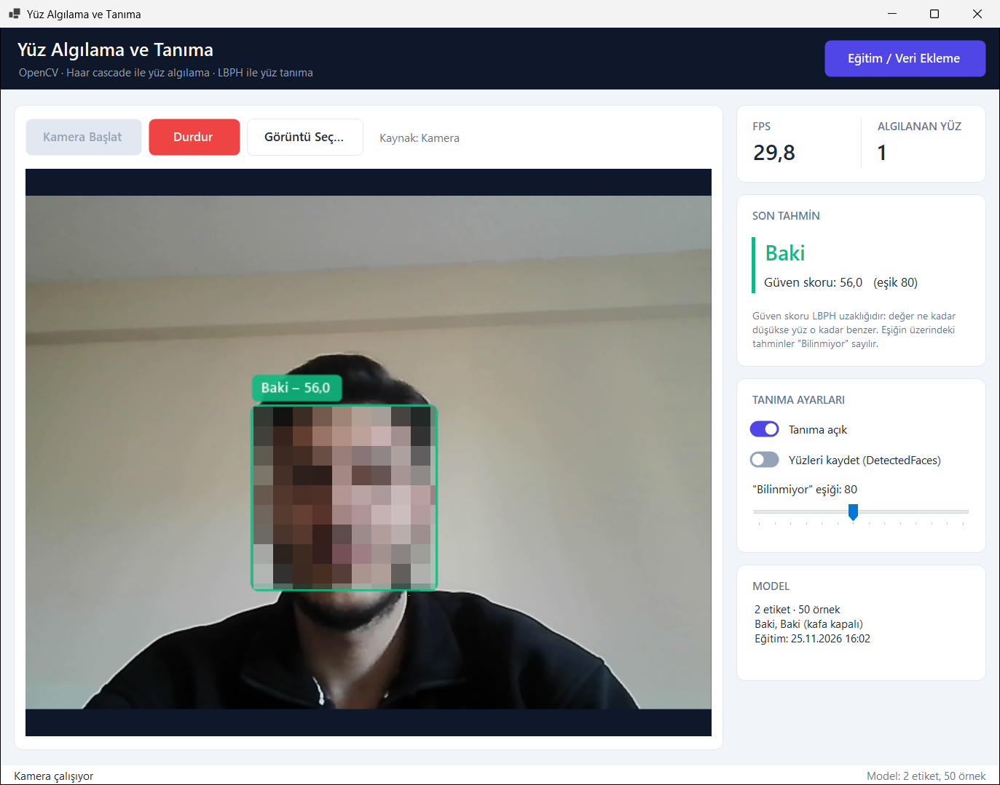
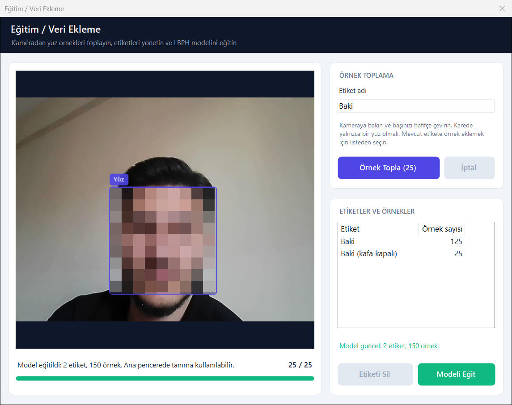

# YMH219-FaceRecognition – OpenCV ile Yüz Algılama ve Tanıma

Kameradan veya seçilen bir resimden yüz bölgelerini algılayan, öğrencinin kendi oluşturduğu küçük yerel örnek küme üzerinde **LBPH** yöntemiyle yüz tanıma yapan C# Windows Forms uygulaması. Algılanan her yüz renkli bir dikdörtgenle işaretlenir; dikdörtgenin üstünde tahmin edilen etiket ve güven skoru (`Etiket – güven`) gösterilir. Uygulamada eğitim / veri ekleme ekranı da bulunur: kameradan yüz örneği toplanır, etiketler yönetilir ve model tek tuşla eğitilir.

> YMH 219 Nesne Tabanlı Programlama – Ek Uygulama Ödevleri, 7. Ödev

## Kullanılan Teknolojiler

| Teknoloji | Açıklama |
|---|---|
| C# / .NET 8, Windows Forms | Masaüstü arayüz (`RollForward=Major`: .NET 8 yoksa daha yeni çalışma zamanında da açılır) |
| [OpenCvSharp4](https://www.nuget.org/packages/OpenCvSharp4) `4.13.0.20261107` | OpenCV için .NET sarmalayıcısı; face (contrib) modülündeki `LBPHFaceRecognizer` dahil |
| [OpenCvSharp4.runtime.win](https://www.nuget.org/packages/OpenCvSharp4.runtime.win) `4.13.0.20261107` | Windows için yerel OpenCV kütüphaneleri |
| [OpenCvSharp4.Extensions](https://www.nuget.org/packages/OpenCvSharp4.Extensions) `4.13.0.20261107` | `Mat` → `Bitmap` dönüşümü |
| Haar cascade (`haarcascade_frontalface_default.xml`) | OpenCV'nin önden yüz algılama modeli ([opencv/opencv](https://github.com/opencv/opencv/tree/4.x/data/haarcascades) deposundan) |

## Kurulum ve Çalıştırma

### Gereksinimler
- Windows 10 / 11 (64 bit; OpenCV yerel kütüphanesi yalnızca x64 için gelir)
- [.NET 8 SDK](https://dotnet.microsoft.com/download/dotnet/8.0) veya daha yeni bir SDK
- Visual Studio 2022 (17.8+) veya Visual Studio 2026, **.NET masaüstü geliştirme** iş yüküyle
- Web kamerası (resimden tanıma için kamera gerekmez)
- İlk derlemede NuGet paketlerini indirmek için internet bağlantısı

> Proje `RollForward=Major` ayarına sahiptir. Bilgisayarda .NET 8 çalışma zamanı yoksa daha yeni bir .NET masaüstü çalışma zamanında (ör. .NET 10) da çalışır.

### Visual Studio ile
1. Depoyu klonlayın:
   ```bash
   git clone https://github.com/bakibasbay/YMH219-FaceRecognition.git
   ```
2. `YMH219-FaceRecognition.sln` dosyasını Visual Studio ile açın.
3. **Derle > Çözümü Derle** (`Ctrl+Shift+B`), ardından **F5** ile çalıştırın.

### Komut satırı ile
```bash
cd YMH219-FaceRecognition
dotnet run --project YMH219-FaceRecognition
```

### Notlar
- **NuGet paketleri** (OpenCvSharp4 ve yerel OpenCV kütüphaneleri) derleme sırasında otomatik indirilir. Ek bir OpenCV kurulumu gerekmez.
- **Cascade dosyası:** `YMH219-FaceRecognition/Cascades/haarcascade_frontalface_default.xml` depoda bulunur ve derlemede çıktı klasörüne (`bin/.../Cascades/`) kopyalanır. Dosya silinirse uygulama açılışta anlaşılır bir uyarı verir; kamera ve resim işlemleri kapanır.
- **Kamera izni:** Windows *Ayarlar > Gizlilik ve güvenlik > Kamera* bölümünde **Kamera erişimi** ve **Masaüstü uygulamalarının kameranıza erişmesine izin verin** açık olmalıdır. İzin kapalıysa, kamera yoksa veya başka bir uygulama (Teams, Zoom vb.) kamerayı kullanıyorsa uygulama bunu mesajla bildirir.

## Kullanım: Veri Topla → Eğit → Tanı

1. **Veri topla:** Ana penceredeki **Eğitim / Veri Ekleme** butonuna basın. Etiket adı yazın (ör. `Baki`) ve **Örnek Topla (25)**'e basın. Kamera kapalıysa kendisi açılır. Kameraya bakıp başınızı hafifçe çevirin; karede tek yüz varken saniyede yaklaşık 5 örnek kaydedilir ve ilerleme çubuğu dolunca toplama durur.
2. **İkinci etiket:** Görünüşünüzü değiştirin (gözlük, şapka, başlık vb.) ve farklı bir etiket adıyla (ör. `Baki (kafa kapalı)`) tekrar örnek toplayın. Var olan bir etikete örnek eklemek için listeden etiketi seçip yeniden **Örnek Topla**'ya basın.
3. **Eğit:** **Modeli Eğit**'e basın. En az iki etiket ve her etikette en az 10 örnek gerekir. Model `model.yml` olarak kaydedilir ve uygulama tekrar açıldığında otomatik yüklenir.
4. **Tanı:** Ana pencerede **Kamera Başlat** ile canlı görüntüde veya **Görüntü Seç…** ile bir resim dosyasında yüzler etiketlenir. Sağ panelde son tahmin ve güven skoru görünür.

### Kendi veri setinizi oluşturma

- Örnekler uygulamanın çalıştığı klasörde `Dataset/<etiket>/*.png` olarak saklanır. Her örnek gri tonlamalı, 100×100 piksel ve histogramı eşitlenmiş bir yüz kesitidir.
- Daha iyi sonuç için her etikette 25–100 örnek toplayın, ışığı yüzünüze önden gelecek şekilde ayarlayın ve toplama sırasında başınızı farklı açılara çevirin.
- Etiket silmek için listeden seçip **Etiketi Sil**'e basın (onay istenir, örnekler kalıcı olarak silinir). Veri seti değiştiğinde eğitim ekranı "modeli yeniden eğitin" uyarısı gösterir.
- Klasörleri elle de düzenleyebilirsiniz: `Dataset/` altında her alt klasör bir etikettir. Değişiklikten sonra modeli yeniden eğitin.

## Özellikler

- Kamera görüntüsünü canlı gösterme (arka plan iş parçacığı, yaklaşık 30 FPS), **Kamera Başlat / Durdur**
- **Görüntü Seç…** ile JPG / PNG / BMP / WEBP / TIFF resimlerde yüz algılama ve tanıma
- Haar cascade ile yüz algılama; **aynı karede birden fazla yüz** ayrı ayrı işaretlenir
- LBPH ile tanıma: etiket + güven skoru; eşiğin üzerindeki tahminler **"Bilinmiyor"** (kırmızı) olarak gösterilir
- Her etiket için ayrı renkte dikdörtgen ve `Etiket – güven` yazısı (Türkçe karakterler GDI+ ile doğru çizilir)
- FPS ve algılanan yüz sayısı göstergesi, durum çubuğu, model bilgisi kartı
- **Tanıma açık/kapalı** anahtarı ve ayarlanabilir **"Bilinmiyor" eşiği** (varsayılan 80)
- **Eğitim / veri ekleme ekranı:** kameradan 25 örnek toplama, ilerleme çubuğu, etiket başına örnek sayısı listesi, etiket silme, model eğitimi ve modelin güncel olup olmadığı bilgisi
- **Yüzleri kaydet** anahtarı: algılanan yüzler saniyede en fazla bir kez `DetectedFaces/<tarih>/` klasörüne renkli PNG olarak kaydedilir
- Hata yönetimi: kamera yok / meşgul / izin kapalı, cascade dosyası yok veya bozuk, model yok / eğitilmemiş / bozuk, geçersiz resim durumlarında anlaşılır mesaj; uygulama çökmez, butonlar duruma göre aktif / pasif olur

### Güven skoru nedir?

LBPH, yüzün yerel ikili desen histogramını eğitim örnekleriyle karşılaştırır ve en yakın örneğin **uzaklığını** döndürür. Bu yüzden skor ne kadar **düşükse** tahmin o kadar güvenilirdir. Uzaklık eşiği aşarsa yüz "Bilinmiyor" sayılır. Kendi örneklerimle yaptığım ayırma testinde (her etiketten her 5. örnek test için ayrıldı) 10 örneğin 10'u doğru tahmin edildi ve uzaklıklar 36–68 arasında kaldı. Varsayılan eşik bu nedenle 80 seçildi.

## Mimari

```
YMH219-FaceRecognition/
├── Program.cs                     Giriş noktası, genel hata yakalama
├── MainForm.cs / .Designer.cs     Ana pencere: görüntü, sonuçlar, ayarlar (OpenCV kodu içermez)
├── TrainingForm.cs / .Designer.cs Eğitim / veri ekleme ekranı
├── Services/
│   ├── CameraService.cs           VideoCapture, arka plan döngüsü, CancellationToken, FrameReady olayı, Dispose
│   ├── FaceDetector.cs            Haar cascade ile algılama, gri tonlama, 100×100 yüz örneği hazırlama
│   ├── FaceRecognizerService.cs   LBPH: eğit, model.yml kaydet/yükle, tahmin (etiket + güven, eşik üstü "Bilinmiyor")
│   ├── DatasetService.cs          Dataset/<etiket>/*.png, etiket listesi, örnek ekle/sil, DetectedFaces kaydı
│   └── FrameAnalyzer.cs           Kare işleme hattı: algıla → tanı → kaydet → Bitmap
├── Models/
│   ├── RecognitionResult.cs       Dikdörtgen, etiket, güven
│   ├── PersonLabel.cs             Etiket adı, örnek sayısı, klasör
│   └── AnalyzedFrame.cs           Gösterilecek Bitmap + bulunan yüzler
├── Controls/                      ModernButton, CardPanel, ToggleSwitch, VideoView, ProgressLine
├── UI/                            Theme (renkler), FaceOverlayRenderer (dikdörtgen + etiket çizimi), ControlExtensions
└── Cascades/haarcascade_frontalface_default.xml
```

- **Akış:** `CameraService` kareyi arka planda okur ve `FrameReady` olayıyla bildirir → form, kareyi aynı iş parçacığında `FrameAnalyzer`'a verir → sonuç (`AnalyzedFrame`) `BeginInvoke` ile arayüze aktarılır → `FaceOverlayRenderer` dikdörtgenleri çizer → `VideoView` yeni Bitmap'i gösterirken öncekini `Dispose` eder.
- Arayüz önceki kareyi henüz göstermediyse yeni kare atlanır. Böylece gecikme birikmez ve bellek sabit kalır (200 karelik testte sızıntı görülmedi).
- Form kapanırken kamera döngüsü `CancellationToken` ile durdurulur; `VideoCapture`, `CascadeClassifier` ve LBPH nesneleri serbest bırakılır.
- Resim, model ve cascade dosyaları bellek üzerinden okunup yazılır; böylece Türkçe karakterli klasör yolları (ör. `Masaüstü`) sorun çıkarmaz. LBPH'nin model dosyasında tuttuğu etiket adları Türkçe karakterleri bozduğu için etiket adları ayrı bir UTF-8 dosyasında (`model.labels.json`) saklanır.

## Ekran Görüntüleri

> Gizlilik nedeniyle ekran görüntülerinde yüz bulanıklaştırılmıştır. Bulanıklaştırma (pikselleştirme) yalnızca depoya eklenen PNG dosyalarına uygulanmıştır; uygulamanın kendisi görüntüyü değiştirmez.

### Canlı kamera: yüz dikdörtgeni, etiket ve güven skoru


### Eğitim / veri ekleme ekranı: etiketler ve örnek sayıları


## Gizlilik ve Kapsam

- Bu çalışma föydeki güvenlik sınırına uygun olarak **yalnızca ders kapsamında, yerel ve gönüllü örneklerle** yapılmıştır. Veri seti yalnızca öğrencinin kendi yüzünün farklı hallerinden oluşur.
- Uygulama kamuya açık alanlarda izinsiz kimlik takibi, gizli görüntü toplama veya kişileri uzaktan izleme amacıyla kullanılmamalıdır. Uygulama arka planda çalışmaz, görüntüleri ağ üzerinden göndermez; tüm veriler bilgisayarda kalır.
- Kişisel yüz görüntüleri ve eğitilmiş model depoya **gönderilmez**: `Dataset/`, `DetectedFaces/`, `model.yml` ve `model.labels.json` `.gitignore` dosyasında hariç tutulmuştur. Depoyu klonlayan kişi kendi veri setini yukarıdaki adımlarla oluşturur.

## Bilinen Sınırlamalar / Geliştirme Notları

- **LBPH ışığa ve açıya duyarlıdır.** Histogram eşitleme farkı azaltsa da örneklerin toplandığı ışıktan çok farklı bir ortamda uzaklıklar büyür ve tahminler "Bilinmiyor"a düşebilir. Bu durumda yeni ortamda örnek toplayıp modeli yeniden eğitmek veya eşiği yükseltmek gerekir.
- LBPH en yakın örneğe göre karar verdiği için çok benzer haller (aynı kişinin gözlüklü / gözlüksüz hali gibi) bazen karışabilir. Örnek sayıları etiketler arasında dengeli tutulursa sonuç iyileşir.
- Haar cascade yalnızca **önden** bakan yüzleri güvenilir şekilde bulur; profilden bakan, çok eğik veya kısmen kapalı yüzleri kaçırabilir, bazen yüz olmayan bölgeleri yüz sanabilir.
- Uygulama varsayılan kamerayı (indeks 0) 640×480 çözünürlükte kullanır; kamera seçimi yoktur.
- Güven skoru yüzde değil, LBPH uzaklığıdır (düşük = daha benzer). Farklı veri setlerinde uygun eşik değişebilir.
- Olası geliştirmeler: DNN tabanlı algılama (ör. YuNet) ve yüz gömme (embedding) ile daha dayanıklı tanıma, birden fazla kamera seçimi, dosyadan resimle örnek ekleme.

## Öğrenci

**Muhammed Baki Başbay** – 250541016

YMH 219 Nesne Tabanlı Programlama – Ek Uygulama Ödevleri
